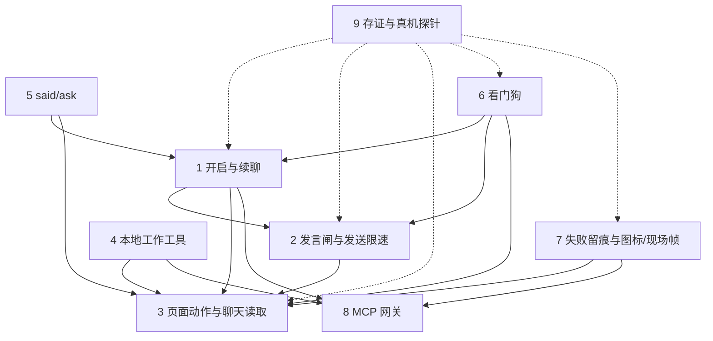

# 当前功能验收地图: 依赖图

> 这是 GitHub map [#109](https://github.com/copytht/dsb/issues/109) 的依赖图与域索引.
> 终点, 判定词, 证据门槛, 修复边界与 out of scope 写在 map 里, 这里不重复.
> Baseline: `fa55d61` (2026-10-20).

## 9 个域

| #   | 域                    | 一句话范围                                              | 判定票 |
| --- | --------------------- | ------------------------------------------------------- | ------ |
| 1   | 开启与续聊            | 启用开关, 围栏续聊, 请求体替换, 轮数/块数上限, 草稿暂存 | #110   |
| 2   | 发言闸与发送限速      | speak 只管发送, 3-15s Beta 限速, 停止不延迟             | #111   |
| 3   | 页面动作与聊天读取    | 动作名册, 选择器, 聊天/侧栏/消息读取, `send.page`       | #112   |
| 4   | 本地工作工具          | `ls/read/grep/write/edit`, 沙箱, 权限, 结果上限         | #113   |
| 5   | said/ask              | ask 围栏角标, 围栏外散文转 `said_add/read`              | #114   |
| 6   | 看门狗                | 静默催办, 会话漂移, 生成中/闸关跳过                     | #115   |
| 7   | 失败留痕与图标/现场帧 | 失败日志, 恢复时间, 图标, 现场帧                        | #116   |
| 8   | MCP 网关              | `/mcp` 端点, 第三方 server 聚合, 超时/配额              | #117   |
| 9   | 存证与真机探针        | 控件原件, 截图, 真机对账, probe                         | #118   |

域 3 的安全子集点击矩阵读数见 [evidence/controls.md](../evidence/controls.md) 的
"真机点击矩阵"节; 有副作用的动作仍未点, 缺口保留.

## 依赖图

实线 = 运行时/行为依赖. 虚线 = 证据依赖: 9 的真机状态/帧需要这些域先有可复现的现场.

## 边读法

| 边               | 为什么                                            |
| ---------------- | ------------------------------------------------- |
| 1 -> 2           | 续聊发的那一条必须过 speak 闸与唯一限速           |
| 1 -> 3           | 续聊落草稿/发送要用写作框与页面动作               |
| 1 -> 8           | 续聊的工具结果经 MCP 中继回灌                     |
| 2 -> 3           | 限速挂在发送动作上, 闸也读发送动作                |
| 4 -> 3           | `send.page` 是本地工具, 但落点是页面动作          |
| 4 -> 8           | 工作工具由扩展经 MCP 网关调用                     |
| 5 -> 1           | ask 围栏与续聊共用同一套围栏解析/轮次             |
| 5 -> 3           | 角标与 hover 问题挂在聊天消息工具栏上             |
| 6 -> 1           | 催办走续聊那条发送路                              |
| 6 -> 2           | 催办也过闸/限速; 生成中/闸关跳过                  |
| 6 -> 3           | 漂移回退与页面状态读取要页面动作                  |
| 7 -> 3           | 动作失败是失败痕的事件来源之一                    |
| 7 -> 8           | 中继/健康失败也是失败痕的事件来源                 |
| 9 -.-> 1,2,3,6,7 | 截图/帧要对上这些域的真实状态, 状态不出现就补不了 |

## 开图顺序

1. 第一批: **3** 与 **8** (根, 可并行).
2. 第二批: **2**, **4**, **7**.
3. 第三批: **1**.
4. 第四批: **5** 与 **6** (可并行).
5. 最后: **9** (汇, 等前面的状态与证据齐).

依赖只决定"什么时候能开", 不决定优先级. 同一批里先开哪张由当次 session 选.

## 不在图里

- 新功能, 重构, 性能, 文案, 体验优化.
- 未来 ADR 与未交付方向.
- 重新启用原生 `chat/continue`; 已决定不用.
- 历史票 #99-#108: 只作为当前行为的来历, 不重开; 判定发现未验项时在新票里记缺口.
